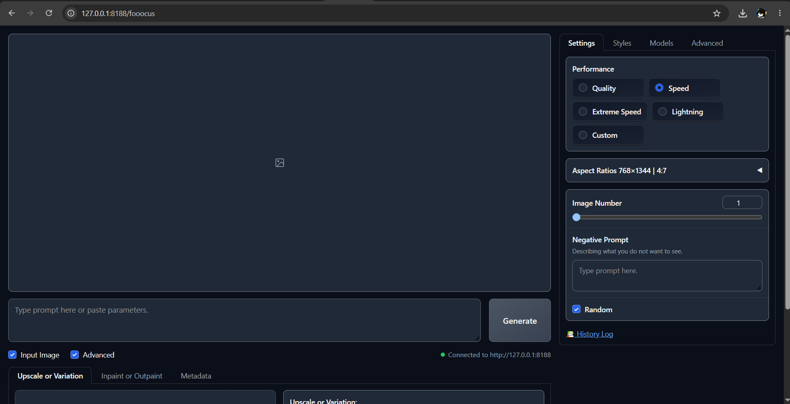

# Fooocus-style UI for ComfyUI

A single-page web interface in the spirit of [Fooocus](https://github.com/lllyasviel/Fooocus) that runs on top of
ComfyUI. ComfyUI stays the engine; this page builds the workflow for you from a prompt and a few settings.

It adds **no nodes** and has **no dependencies**. After installing, open:

```
http://127.0.0.1:8188/fooocus
```



## What it does

- **Text to image** — prompt, negative prompt, performance presets (or a custom step count), the Fooocus aspect
  ratio list (or a custom size), image number, seed, live preview, Skip / Stop.
- **Styles** — the Fooocus style format with hover previews, search and "Random Style".
- **Models** — base model, VAE, five LoRA slots with weights, a Turbo LoRA for Extreme Speed.
- **Workflows** — built-in SDXL and Anima workflows, or import your own (API format).
- **Input Image**
  - *Upscale or Variation* — Vary (Subtle / Strong), Upscale 1.5x / 2x with an upscale model, Fast 2x.
  - *Inpaint or Outpaint* — paint a mask (brush, eraser, undo), three methods, outpaint in four directions,
    mask upload, invert, erode / dilate. The masked region is cropped, redrawn at about 1 MP and pasted back.
  - *Metadata* — reads parameters from PNG files (this UI, ComfyUI, Fooocus, A1111) and applies them.
- **History Log** — every image in the ComfyUI output folder, by day, with its parameters.
- Works on phones (portrait layout).

## Install

**ComfyUI Manager** (once the node is published to the Comfy Registry): search for "Fooocus-style UI", install, restart ComfyUI.

**Manually:**

```
cd ComfyUI/custom_nodes
git clone https://github.com/Tand-Anthros/comfy-fooocus-ui.git
```

Restart ComfyUI and open `http://127.0.0.1:8188/fooocus`.

To use it from another device (a phone on the same network), start ComfyUI with `--listen` and open
`http://<address of the computer>:8188/fooocus`.

## Styles

Styles are read from `styles/*.json` in this folder (Fooocus format: a list of
`{"name", "prompt", "negative_prompt"}`, where `{prompt}` marks your text). Preview pictures are read from
`styles/samples/<style name>.jpg`.

The easiest way to fill the folder is to copy the contents of `sdxl_styles` from a Fooocus install, including
`samples`. Without the folder the page downloads the original Fooocus style files from GitHub on first use and
keeps them in the browser.

No style is selected by default: the prompt is sent as typed.

## LoRA folders

LoRAs are listed per workflow: the subfolder of `models/loras` whose name contains the workflow name
(for example `anima`, `lora_sdxl`) plus the files in the root of `models/loras`.

LoRA files with **`turbo`** in the name are treated as speed LoRAs: they are hidden from the regular slots and
offered as the *Turbo LoRA* at the bottom of the Models tab. It is chosen once per workflow and added automatically
when Performance is *Extreme Speed* (8 steps, CFG 1) or *Lightning* (4 steps, CFG 1).

## Your own workflows

Models tab → *Import workflow (API JSON)*. Export it from ComfyUI with *Workflow → Export (API)*. The workflow needs
a regular `KSampler`; prompt, size, seed, steps, CFG, sampler, model files and LoRAs are wired in automatically.

## Optional extensions

Everything above works on a plain ComfyUI. These are detected automatically and only add features:

| Extension | Adds |
|---|---|
| [ComfyUI Inpaint Nodes](https://github.com/Acly/comfyui-inpaint-nodes) + the Fooocus inpaint files in `models/inpaint` | Fooocus inpaint engine (SDXL only) |
| [segment anything](https://github.com/storyicon/comfyui_segment_anything) | Mask generation from a text prompt |
| [ComfyUI-WD14-Tagger](https://github.com/pythongosssss/ComfyUI-WD14-Tagger) | "Describe" (booru tags) for images without metadata |

## Using the page without installing

`fooocus-comfy.html` also works opened directly as a file. ComfyUI must then be started with
`--enable-cors-header`, and the address is set on the Advanced tab. In this mode styles come from GitHub and the
History Log only knows images made from that browser and since ComfyUI was last started.

## Limitations

- This is not Fooocus: its sampler internals (sharpness, adaptive CFG) and the "Fooocus V2" prompt expansion are
  not part of ComfyUI and are not reproduced.
- Without the optional inpaint extension, inpainting uses a noise mask with Differential Diffusion.

## Credits

The interface layout, wording and style format follow [Fooocus](https://github.com/lllyasviel/Fooocus) by
lllyasviel (GPL-3.0). No Fooocus source code is included. Built on [ComfyUI](https://github.com/comfyanonymous/ComfyUI).

## License

GPL-3.0-or-later. See [LICENSE](LICENSE).
